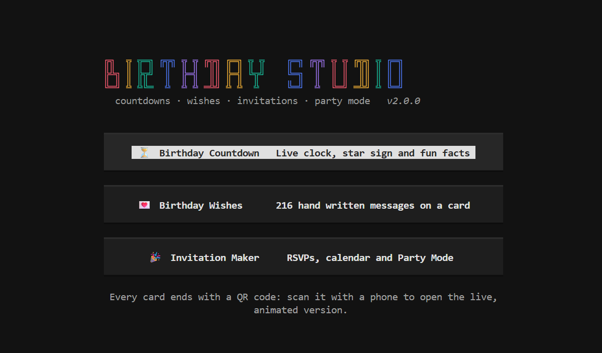
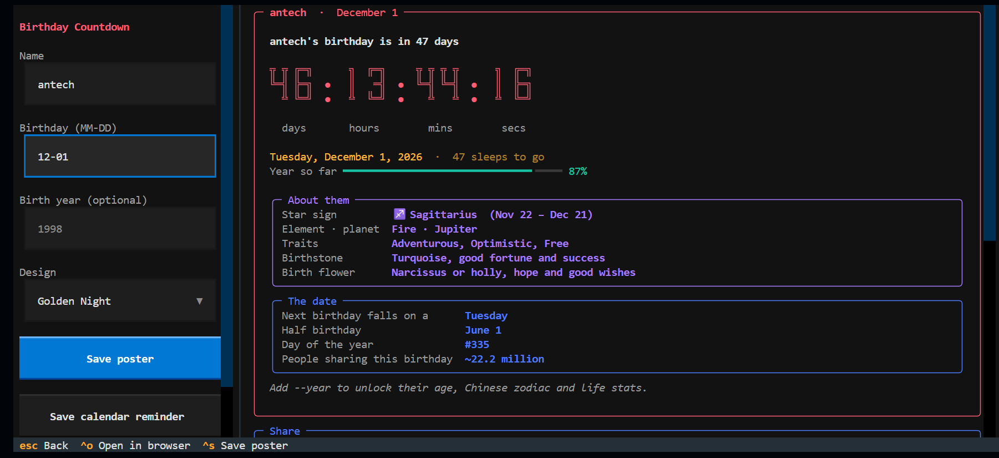
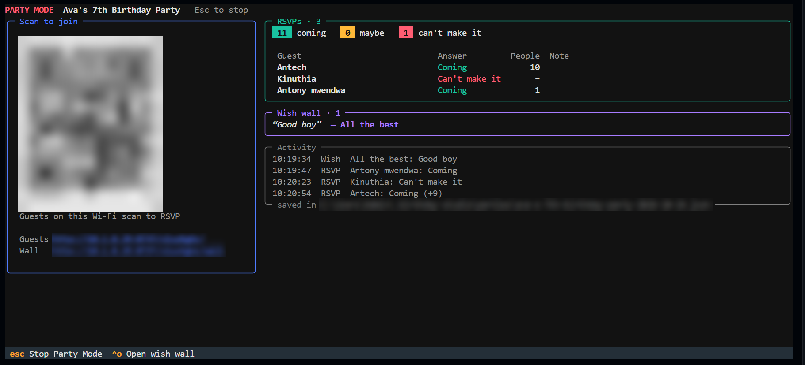

<div align="center">

# Birthday Studio

**A countdown, a card and an invitation, all drawn live in the browser.**

<a href="https://birthday-gift-wish.vercel.app/"></a>

<a href="https://github.com/Antech-greyhat/Birthday-Gift/stargazers"></a>
<a href="https://github.com/Antech-greyhat/Birthday-Gift/network/members"></a>
<a href="https://github.com/Antech-greyhat/Birthday-Gift/watchers"></a>
<a href="https://github.com/Antech-greyhat/Birthday-Gift/graphs/contributors"></a>
<br />
<a href="https://github.com/Antech-greyhat/Birthday-Gift/issues"></a>
<a href="https://github.com/Antech-greyhat/Birthday-Gift/pulls"></a>
<a href="https://github.com/Antech-greyhat/Birthday-Gift/commits/master"></a>


`React 19` · `Tailwind CSS 4` · `Vite 8` · `Motion` · `Canvas 2D` · `MediaRecorder`

**[Try it live](https://birthday-gift-wish.vercel.app/)** · **[Star the repo](https://github.com/Antech-greyhat/Birthday-Gift/stargazers)** · **[Fork it](https://github.com/Antech-greyhat/Birthday-Gift/fork)** · **[Report a bug](https://github.com/Antech-greyhat/Birthday-Gift/issues/new)** · **[Contribute](#contributing)**

</div>

> Most birthday sites stop at the text. Birthday Studio goes one step further: the finished countdown, wish or invitation becomes a poster or a short video with music, sized for a feed post or a story, ready to send from the same screen.

---

## Live Demo

The app is live at **[birthday-gift-wish.vercel.app](https://birthday-gift-wish.vercel.app/)**. There's no sign-up and nothing to install, so you can open it on your phone and send a card in under a minute.

| Jump straight to | Link |
| --- | --- |
| Birthday Countdown | [birthday-gift-wish.vercel.app/#/countdown](https://birthday-gift-wish.vercel.app/#/countdown) |
| Birthday Wishes | [birthday-gift-wish.vercel.app/#/wishes](https://birthday-gift-wish.vercel.app/#/wishes) |
| Invitation Maker | [birthday-gift-wish.vercel.app/#/invitation](https://birthday-gift-wish.vercel.app/#/invitation) |

---

## The Programme

The app opens on a single page with three cards. Each card leads to a tool, and each tool ends at the same share sheet.

| Act | Tool | You bring | You leave with |
| :-: | --- | --- | --- |
| I | **Birthday Countdown** | A name and a birthday, optionally the year | A live clock, star sign, birthstone, life stats and a link that keeps counting |
| II | **Birthday Wishes** | Who it is for, the mood, two names | One of 216 written wishes on a designed, animated card |
| III | **Invitation Maker** | Party date, place and RSVP details | An invitation that guests can open, RSVP to and add to their calendar |

---

## Act I · Birthday Countdown

Enter their name and pick a month and day. The clock starts immediately and ticks every second with rolling digits. Adding the birth year unlocks the rest of the page.

| Shown without a year | Unlocked by the year |
| --- | --- |
| Days, hours, minutes and seconds | Age being turned |
| Zodiac sign, element and ruling planet | Chinese zodiac animal |
| Birthstone with its meaning | Weekday of birth and its line from the old nursery rhyme |
| Birth flower | Generation |
| Next birthday weekday, half birthday, day of the year | Days on Earth, heartbeats, breaths, full moons, distance travelled around the Sun, leap days lived |

Small details that matter on the day:

| Situation | Behaviour |
| --- | --- |
| The birthday is today | Confetti fires, the heading switches to a greeting and the clock moves on to next year |
| Born on 29 February | Celebrated on 28 February in common years |
| Born near Lunar New Year | The Chinese zodiac is flagged as possibly the previous animal |
| Someone opens your link | The page restores the name and date from the address and keeps counting |

---

## Act II · Birthday Wishes

Every message is written by hand and tagged by who it suits and how it sounds.

| Written for | Tones |
| --- | --- |
| Anyone, Mom, Dad, Wife, Husband, Partner, Best friend, Friend, Sister, Brother, Daughter, Son, Grandparent, Coworker, Boss | Heartfelt, Funny, Short, Inspiring |

| Collection | Messages |
| --- | --: |
| Universal wishes, 12 per tone | 48 |
| Personal wishes, 14 recipients with 3 per tone each | 168 |
| **Total** | **216** |

When no name is typed, the wish still reads naturally. "Happy birthday, {name}!" becomes "Happy birthday, Mom!" for a mother and simply "Happy birthday!" for a coworker. The text stays editable, and a shared link opens the finished card for the person receiving it, with an option to send one back.

---

## Act III · Invitation Maker

The editor opens with a filled-in example party, so the preview never starts empty. Drafts are saved in the browser between visits.

| Section | Fields |
| --- | --- |
| Theme and style | Ten themes, eight accent swatches plus a custom picker, five fonts for the name |
| Who | Headline, birthday star, age being turned |
| When and where | Date, start and end time, venue, address |
| Details and RSVP | Dress code, note for guests, host, phone or email, reply-by date |

The invitation link carries the whole party inside it, so nothing is stored on a server. Guests who open it see:

| Guest action | What happens |
| --- | --- |
| RSVP on WhatsApp | Opens a reply to the host's number, already written |
| Add to calendar | Downloads an event with the time, place and a reminder a day before |
| Directions | Opens the venue in Google Maps |
| Make your own | Leads back to a fresh editor |

---

## The Share Sheet

All three tools hand off to one share sheet. It slides up from the bottom on phones and opens as a dialog on larger screens.

| Choice | Options |
| --- | --- |
| Size | Post 1:1 (1080 × 1080), Portrait 4:5 (1080 × 1350), Story 9:16 (1080 × 1920) |
| Format | Photo as PNG, or video as MP4 with WebM fallback |
| Video length | 6 seconds, or 10 seconds with the music on |
| Soundtrack | A music box arrangement of Happy Birthday, synthesised in the browser |

| Where it goes | How |
| --- | --- |
| WhatsApp, Facebook, X, Telegram, LinkedIn, Pinterest, Reddit, Messages, Email | Opens that network's own share page with the text and link |
| Instagram, TikTok, Snapchat | Hands the photo or video to the phone's share sheet; on desktop the file is saved for upload |
| Anywhere else | Copy link, copy text, or download the file |

---

## Card Designs

The same ten designs are used by the wish cards, invitations and countdown posters.

| Design | Mood | Moving parts |
| --- | --- | --- |
| Confetti Pop | Cheerful, warm cream | Falling paper confetti |
| Golden Night | Formal, midnight and gold | Bokeh, twinkling stars, gold frame |
| Pastel Dream | Soft and gentle | Drifting clouds, pastel light |
| Balloon Sky | Playful, made for kids | Rising balloons |
| Sunset Glow | Bold gradient | Expanding sun rings, sparkles |
| Garden Bloom | Romantic, botanical | Swaying flower corners |
| Neon Party | Night out | Pulsing neon frames and shapes |
| Simple Ink | Minimal, editorial | Slow confetti, double frame |
| Party Time | Loud and fun | Bunting, moving stripes |
| Sweetheart | Love and family | Floating hearts |

---

## Getting It On Screen

There is nothing to sign up for and no server code. Node 20.19 or 22.12 and newer is enough.

| When you want to | Type | Result |
| --- | --- | --- |
| Fetch the dependencies, once | `npm install` | A `node_modules` folder |
| Work on it with live reload | `npm run dev` | The app at `localhost:5173` |
| Produce the deployable site | `npm run build` | Static files in `dist/` |
| Check that build locally | `npm run preview` | The built site at `localhost:4173` |

The build uses relative paths and hash routing, so `dist/` can be dropped into GitHub Pages, Netlify, an S3 bucket or any subfolder without extra configuration.

---

## Encore · The Terminal App

The same three tools also run in a terminal, written in Python and kept in `cli/`. That folder is never deployed. You get it by cloning the repo and running it on your own computer.

<p align="center">
  
  <br />
  <sub>The launcher that opens when you run <code>bday</code></sub>
</p>

```bash
git clone https://github.com/Antech-greyhat/Birthday-Gift.git
cd Birthday-Gift/cli
pipx install .           # or install into a virtual environment, see below
bday                     # opens the full screen app
```

Python 3.10 or newer is required. On Windows, Windows Terminal draws the QR codes best. Linux distributions such as Kali, Debian and Ubuntu block a plain `pip install .` with an `externally-managed-environment` error. Use pipx (`sudo apt install pipx`), or create a virtual environment first: `python3 -m venv .venv && source .venv/bin/activate && pip install .`

To update to the latest version, run `git pull` in your clone, then reinstall from the `cli` folder with `pipx install --force .` (or `pip install --upgrade .` inside your virtual environment). Your Party Mode replies are kept. The [terminal app README](cli/README.md#update) covers every install type.

| Type | You get |
| --- | --- |
| `bday` | A full screen app with forms, live previews and keyboard shortcuts |
| `bday countdown Ava 05-14 --year 1998 --live` | A ticking clock with star sign, birthstone and life stats |
| `bday wish --to Ava --from Sam --for bestie --mood funny` | A wish from the same 216 messages, on a card |
| `bday invite --example --poster party.png` | An invitation, a calendar file and a printable poster |
| `bday party party.json` | Party Mode, see below |
| `bday share <link>` | A QR code and share links for any address |
| `bday list designs` | The card designs, recipients and moods to choose from |

<p align="center">
  
  <br />
  <sub>The countdown: a form on the left, the live clock and facts on the right</sub>
</p>

**Scan to open.** Every card ends with a QR code printed in the terminal. The code holds the same [shareable address](#shareable-addresses) the website makes, so a phone camera opens the full animated card on the live site. Nothing is uploaded. Add `--poster file.png` to save a printable poster with the code on it, or `--links` for WhatsApp, Telegram, X, Facebook and email links.

**Party Mode.** `bday party` turns your computer into the party's front desk, with no internet needed:

| Step | What happens |
| --- | --- |
| 1 | A QR code appears in your terminal. Print it with `--poster` or show it on screen |
| 2 | Guests on the same Wi-Fi scan it and open the invitation from your computer |
| 3 | They RSVP and leave a birthday wish. Both show up live in your terminal |
| 4 | Open the wish wall link on a TV and the wishes appear as they come in |
| 5 | Press Ctrl+C to stop. Replies are saved, so running it again picks up where you left off |

<p align="center">
  
  <br />
  <sub>Party Mode: guests scan to join, and RSVPs and wishes arrive live. The QR code, addresses and file path are blurred here</sub>
</p>

Only devices on your network can reach it. Each party gets a random address, and the server stops when you close it. The [terminal app README](cli/README.md) lists every command and option.

---

## Backstage

```
src/
├── pages/Home.jsx            the three tool cards
├── tools/
│   ├── registry.js           names, colors and routes for every tool
│   ├── countdown/            page, astrology data, time maths, poster
│   ├── wishes/               page, message library, card
│   └── invitation/           page, text formatting, card
├── components/               layout, share sheet, live preview, pickers, toasts
├── lib/
│   ├── canvas/               layout engine, decorations, themes
│   ├── media/                video recorder and melody synthesiser
│   └── share, calendar, url, fonts helpers
├── hooks/                    ticking clock, saved state
└── styles/index.css          design tokens and component classes

cli/                          the terminal app, never deployed
├── birthday_cli/
│   ├── app.py                the bday command
│   ├── tui/                  the full screen app
│   ├── core/                 countdown maths, star signs, wishes, invitations
│   ├── share/                links, QR codes and the Party Mode server
│   ├── render/               printable posters
│   └── data/wishes.json      the wish library, copied from the web app
└── tests/
```

The central idea is that every poster is one function:

```js
draw(ctx, width, height, time)
```

| Called by | With | To produce |
| --- | --- | --- |
| The live preview | Elapsed time, every frame | The animated card on screen |
| Photo export | A fixed time after all animations finish | A crisp PNG at full size |
| Video export | Real time, recorded for 6 or 10 seconds | The animated MP4 or WebM |

Because a single function draws all three, the download always matches the preview exactly. Layouts measure their own text and shrink until everything fits, so long names and long addresses stay inside the frame in every size.

---

## Shareable Addresses

State lives in the URL, which is what makes the links work without a backend.

| Route | Parameters | Example |
| --- | --- | --- |
| `#/countdown` | `n` name, `m` month, `d` day, `y` year, `t` design | `#/countdown?n=Ava&m=5&d=14&y=1998` |
| `#/wishes` | `view=1`, `n` name, `f` from, `d` design, `m` message | `#/wishes?view=1&n=Sam&d=golden&m=...` |
| `#/invitation` | `view=1`, `p` the whole invitation, packed | `#/invitation?view=1&p=eyJoZWFk...` |

Shared invitations are checked on arrival: unknown fields are dropped, text is length-limited, and colors and fonts must match known values.

---

## House Rules

| Principle | In practice |
| --- | --- |
| Private by default | No accounts, no analytics, no server. Drafts stay in the browser's local storage |
| Mobile first | Layouts start at phone width, controls scroll horizontally, the share sheet is a bottom sheet |
| Motion with restraint | Every animation respects the system "reduce motion" setting |
| Accessible | Labelled fields, keyboard focus rings, live regions for the countdown and notifications |
| Light to load | Each tool is its own chunk and loads only when it is opened |

| Browser | Photo | Video |
| --- | :-: | :-: |
| Chrome, Edge | Yes | Yes |
| Firefox | Yes | Yes, as WebM |
| Safari 17 and newer | Yes | Yes |
| Older browsers | Yes | Shows a notice instead |

Some browsers say they can record MP4 but save files without a picture. The recorder inspects each finished video and quietly records again as WebM when that happens.

---

## Show Some Love

If Birthday Studio made someone's day, help it reach more people.

| How | Why it helps |
| --- | --- |
| **[Star the repo](https://github.com/Antech-greyhat/Birthday-Gift/stargazers)** | Tells others the project is worth a look and keeps it going |
| **[Fork it](https://github.com/Antech-greyhat/Birthday-Gift/fork)** | Your own copy to experiment with, restyle or build on |
| **Share the [live demo](https://birthday-gift-wish.vercel.app/)** | The next birthday is always closer than you think |
| **[Open an issue](https://github.com/Antech-greyhat/Birthday-Gift/issues/new)** | Bugs, ideas and feature requests are all welcome |

<div align="center">

<a href="https://github.com/Antech-greyhat/Birthday-Gift/stargazers"></a>
<a href="https://github.com/Antech-greyhat/Birthday-Gift/fork"></a>

</div>

---

## Contributing

Contributions of every size are welcome, from a typo fix to a whole new card design.

### Ways to help

| Area | Ideas |
| --- | --- |
| Card designs | A new theme in `src/lib/canvas/themes.js`, with its own background and moving parts |
| Wishes | More hand-written messages, recipients or tones in `src/tools/wishes/messages.js`, copied to `cli/birthday_cli/data/wishes.json` too |
| Terminal app | New commands, Party Mode features or terminal designs in `cli/` |
| Languages | Translating the interface and wishes |
| Accessibility | Screen reader, keyboard and contrast improvements |
| Bugs | Anything that looks wrong on a phone, in a browser or in an exported video |

### Steps

1. **Fork** the repository and clone your fork:
   ```bash
   git clone https://github.com/<your-username>/Birthday-Gift.git
   cd Birthday-Gift
   npm install
   ```
2. **Create a branch** named after your change:
   ```bash
   git checkout -b feat/sparkly-new-theme
   ```
3. **Make your change** and try it with `npm run dev`.
4. **Check the build** passes with `npm run build`. For changes in `cli/`, run `pip install -e ".[dev]"` and then `pytest` inside that folder.
5. **Commit** with a clear message, for example `feat: add aurora card theme` or `fix: year validation for babies born this year`.
6. **Push** to your fork and **open a pull request** against `master`. Describe what changed, and add a screenshot for anything visual.

### Guidelines

| Do | Please avoid |
| --- | --- |
| Match the surrounding code style and naming | Adding a dependency when a few lines would do |
| Keep each pull request focused on one change | Mixing unrelated fixes in one pull request |
| Test at phone width as well as desktop | Breaking the "reduce motion" behaviour |
| Keep everything client-side and private | Adding tracking, analytics or a server |

Not sure where to start? Look through the [open issues](https://github.com/Antech-greyhat/Birthday-Gift/issues) or open a new one to talk an idea through first.

---

## Contributors

Thanks to everyone who has helped build Birthday Studio.

<a href="https://github.com/Antech-greyhat/Birthday-Gift/graphs/contributors">
  
</a>

---

## Repository Stats

<div align="center">

<a href="https://github.com/Antech-greyhat/Birthday-Gift">
  
</a>

<br /><br />

<a href="https://star-history.com/#Antech-greyhat/Birthday-Gift&Date">
  <picture>
    <source media="(prefers-color-scheme: dark)" srcset="https://api.star-history.com/svg?repos=Antech-greyhat/Birthday-Gift&type=Date&theme=dark" />
    
  </picture>
</a>

</div>

---

<div align="center">

**Built for the people who remember birthdays, and the people who are trying to.**

</div>
